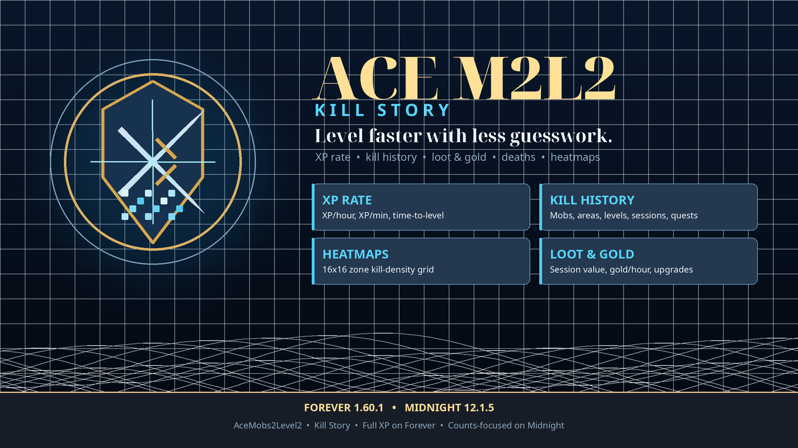

# Ace Mobs 2 Level 2 — Kill Story

**Level faster with less guesswork.**

AceM2L2 turns WoW leveling into readable progress: kills-to-level, reputation
repeats, XP rate, kill history, quest XP, loot value, death locations, respawn
timers, and per-zone kill heatmaps. It works on **Forever 1.60.1** and
**Midnight 12.1.5**, with full XP estimates on Forever and a counts-focused
experience on Midnight.

## Why install it?

- **Know the next level.** See kills remaining, XP remaining, XP/hour, and time
  to level.
- **Know what you killed.** Kill Story tracks mobs, levels, areas, sessions, and
  most-killed creatures.
- **Know where to grind.** Zone heatmaps show where your kills cluster; death
  locations and respawn intervals add context. The heatmap uses static zone-map
  art beneath a kill-density grid, with an optional full-terrain reveal for
  unexplored areas. It is not a live map.
- **Make it yours.** Resizable window, multiple themes, scale control, heatmap
  intensity/color controls, and a minimap launcher.
- **Inspect your data.** Middle-click the minimap icon to see tracked counts,
  limits, heatmap cells, and estimated store size.
- **Know what it is worth.** Track session loot value, gold/hour, and gear
  upgrades.
- **Keep quests separate.** On Forever, quest XP has its own ledger and never
  pollutes kill averages.

## Feature highlights

| Progress | History | World | Economy |
|---|---|---|---|
| Kills-to-level | Kill Story window | Death locations | Loot value |
| XP remaining | Mob/area/level history | Respawn intervals | Gold/hour |
| XP/hour and XP/minute (Forever) | Quest XP ledger (Forever) | Grinding spots (Forever) | Gear upgrades |
| Time-to-level (Forever) | Leveling history | Zone heatmaps | Session totals |
| Reputation repeats | Dungeon XP, goals, splits | Optional nameplate levels (Midnight) | Gear-upgrade alerts |

XP estimates, kills-to-level, XP rate, calibration, rested/buff models, quest
XP, dungeon XP, and grinding spots are Forever-only. Midnight is counts-focused
and keeps the non-XP history; nameplate levels are Midnight-only.
 
## Built for both clients

**Forever 1.60.1 — full mode**

- Full XP formula, tooltip estimates, calibration, and 3D mob model card.
- XP rate, time-to-level, and grinding-spot suggestions.
- Well Fed XP Boost, Well-Rested, Camp Tent rested XP, and active XP bonuses.
- Quest XP, leveling history, loot, gold, deaths, respawns, and heatmaps.

**Midnight 12.1.5 — counts-focused mode**

- Kill, area, level, session, dungeon, goal, split, loot, gold, death, respawn,
  and heatmap features without XP claims.
- Optional level text above nameplates.
- Same Kill Story window, themes, search, and minimap launcher.

## A quick look

- Open the window with `/acem2l2 xpt ui`, `/acem2l2 history`, the minimap icon,
  the addon compartment, or `Ctrl+Shift+X`.
- Open settings with `/acem2l2 config`.
- Discover commands in game with `/acem2l2 help` and `/acem2l2 xpt help`.
- Tabs: **Overview, Mobs, Areas, Heatmap, Levels**.
- The Heatmap tab can be hidden in Settings while data still records.

## Install

1. Copy the `AceM2L2` folder into `Interface/AddOns/`.
2. Enable the addon and run `/reload`.
3. No external Ace3 install is required; libraries are embedded.

## Good to know

- Heatmaps keep up to 40 zones; death history keeps 100 deaths; respawn tracking
  keeps 300 NPCs with 20 samples each.
- Mob history keeps 2000 mobs per client; quest and level history keep 200
  records each; rate history keeps 240 samples.
- Heatmaps, death locations, respawns, and nameplate levels depend on the
  client's map-position and nameplate APIs.
- Grinding spots need at least 5 kill-XP samples over 120 seconds.
- Midnight XP estimates, calibration, kills-to-level, rested, and buffs remain
  off until its data is live-verified.

## Changelog

### 2.4.4

- Heatmaps now use a multi-stop gradient (theme accent to gold to red) instead
  of a single accent colour, with a Low-to-High legend bar.
- Intensity now adjusts contrast so the weakest and hottest cells stay distinct
  at every setting, including 200%.

### 2.4.3

- Heatmap refreshes recolor active cells in place when a new cell maximum
  appears, instead of rebuilding the whole cell pool.

### 2.4.2

- Moved heatmap controls to their own Settings > Heatmap subpage.

### 2.4.1

- Rewrote the player readme as a concise feature guide with a short
  performance/data note.

### 2.4.0

- Added heatmap intensity and warm-color settings.
- Added a data diagnostics frame, opened by middle-clicking the minimap icon or
  `/acem2l2 xpt data`.
- Clarified that mob/quest/death caps are per character and per client, not per
  zone.

### 2.3.1

- Strengthened the heat-cell alpha ramp so low- and mid-density cells remain
  visible over the full zone-map art.

### 2.3.0

- Added full zone-map overlays generated from the official client tables, so
  unexplored areas can show their real map art immediately.
- Added a "Reveal unexplored areas" setting, on by default.

### 2.2.1

- Discovered areas now use Blizzard's explored-map overlays; undiscovered areas
  keep the base parchment-style art.

### 2.2.0

- Heatmap resolution increased to 64x64 with legacy 16x16/32x32 migration,
  lazy cell creation, and incremental refreshes.

### 2.1.6

- Zone-map art now renders above the grid backdrop at full opacity, removing the
  faded blue tint.

### 2.1.5

- Heatmap upgraded to a 32x32 grid with legacy 16x16 data migration and
  stronger heat colors.

### 2.1.4

- Cached the tiled zone-map art and capped layer/tile work so refreshes and
  resizing stay responsive.

### 2.1.3

- Heatmaps now resolve the correct zone map ID and render Blizzard's tiled zone
  map art, not a continent/world-map background.

### 2.1.2

- Zone-map art is now visible beneath the heatmap grid; empty cells no longer
  cover the map.
- The default window is about 15% larger, and the window supports safe resizing
  with heatmap reflow.

### 2.1.1

- Added the Kill Story logo to the addon icon, minimap launcher, window header,
  and Settings branding.

### 2.1.0

- User-facing documentation refresh and Kill Story naming throughout.
- Reliability fixes for settings ranges, world/economy normalization, tooltip
  hooks, debug output, migration, and restricted API data.

### 2.0.0

- Major feature release: XP rate and time-to-level, dungeon XP, leveling goals,
  level-time splits, loot value, gold/hour, gear upgrades, death locations,
  respawn tracking, grinding spots, optional nameplate levels, and per-zone
  kill heatmaps.

See `README.txt` in the addon for the player guide and condensed changelog.

## Links

- Player guide: [README.txt](README.txt)
- Developer reference: [README.md](README.md)
- License: [LICENSE](LICENSE)
