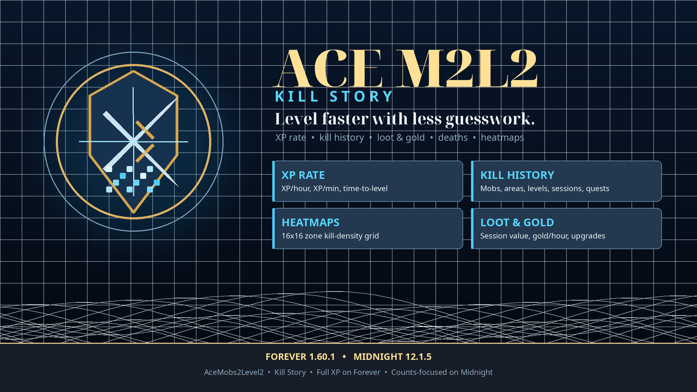

# Ace Mobs 2 Level 2 (AceM2L2)

AceM2L2 is a World of Warcraft addon that reports XP and reputation progress
and provides a **Kill Story** browser for Forever 1.60.1 and Midnight 12.1.x.
Forever gets the full XP/tooltip experience; Midnight gets counts-focused
history plus the non-XP features until its XP data is live-verified.

- **Version:** 2.5.2
- **Author:** faslkjd56
- **Interfaces:** Midnight `120105`/`120107`, Forever `16001`
- **Clients:** Midnight 12.1.5 retail, 12.1.7 PTR interface-ready, Forever 1.60.1
- **License:** GNU GPL v3

The player-facing guide is [`README.txt`](README.txt). This document covers the
project structure, tracking model, development workflow, and release packaging.
Promotional artwork and the CurseForge-style brochure are in
[`BROCHURE.md`](BROCHURE.md).

[](BROCHURE.md)

## Overview

AceM2L2 has two layers:

1. **Core addon** (`ACEM2L2.lua` bootstrap plus `Core/`) — XP-to-level and
   reputation-to-next-rank messages for both Midnight and Forever.
2. **Kill Story module** (`KillHistory/`) — per-character kill tracking on
   both clients, with tooltip estimates and calibration on Forever and
   counts-focused tracking on Midnight.

Kill Story is the display name. The internal folder `KillHistory/`, module ID
`XPTooltip`, settings namespace `xpTooltip`, and `/xpt` commands remain for
compatibility.

The Kill Story module auto-disables for unknown clients or when the active
client's required APIs are unavailable. Forever requires its XP APIs; the
Midnight counts-focused profile needs only minimal identity/level APIs. A missing
tooltip hook disables tooltip lines without disabling the tracker or the
window.

## Compatibility

| Client | Project ID | Interface | Core addon | Kill Story |
|---|---:|---:|---|---|
| Forever 1.60.1 | `18` | `16001` | Supported | Full |
| Midnight 12.1.5 | `1` | `120105` | Supported | Counts-focused |
| Midnight 12.1.7 (PTR) | `1` | `120107` | Interface-ready; API audit pending | Counts-focused |

The TOC intentionally lists both interface versions:

```text
## Interface: 120105, 120107, 16001
```

Both clients share the non-XP history: kill counts, heatmap, death locations,
respawn intervals, leveling goals, level splits, dungeon activity, and economy.
The XP layer is still client-specific:

| Capability | Forever | Midnight |
|---|---|---|
| Kills, areas, levels, session | Yes | Yes |
| Heatmap, deaths, respawns | Yes | Yes |
| Dungeon, goal, splits, economy | Yes | Yes |
| XP estimate, tooltip XP, kills-to-level | Yes | No |
| XP rate, time-to-level | Yes | No |
| Grinding-spot recommendations | Yes | No |
| Rested and buff models, calibration | Yes | No |
| Quest XP ledger | Yes | No |
| Nameplate levels | No | Yes (default off) |

## Installation

1. Copy the `AceM2L2` folder into your client's `Interface/AddOns/` directory.
2. The final path must be `Interface/AddOns/AceM2L2/AceM2L2.toc`.
3. Enable the addon and run `/reload`.

No external Ace3 installation is required. The required libraries are embedded
under `Libs/`.

## Core Features

### XP and reputation

- Prints kills-to-level and reputation repeats in chat.
- Handles named and unnamed kills, group/raid bonuses, quests, and rested XP
  through localized `COMBATLOG_XPGAIN_*` strings.
- Uses `PLAYER_XP_UPDATE` and `FACTION_STANDING_CHANGED` as the exact amount
  source instead of relying on parsed chat totals.
- Supports reputation from kills, quests, bonuses, guild rep, paragon, and
  renown factions.
- Uses the modern Settings API on both supported clients.
- Sanitizes saved variables, protects event handlers, and stores the last error
  for `/acem2l2 status`.

### Kill Story

Both clients share one window, list, detail panel, command surface, and data
model. Client-specific policy lives only in `KillHistory/Client.lua` and
`KillHistory/Clients/`.

**Forever 1.60.1 — full mode**

- Tooltip lines for estimated XP, percent of level, XP remaining, mob level,
  kills-to-level, rested bonus, XP bonuses, and per-mob kill counts.
- Forever XP formula with Well Fed XP Boost food (`1243969`, +5% kill XP),
  Well-Rested (`429959`, +1% per stack, up to +3%), and the rested total-pool
  model. The active bonus breakdown matches the multiplier actually applied.
  The Cozy Sleeping Bag uses the same Well-Rested aura; Camp Tent `1307230`
  tops up the rested pool and is shown through the rested line.
- Per-character tracking by mob, player level, and area.
- Quest XP ledger with totals, per-quest rewards, `/xpt quests`, and an Overview
  summary; quest XP never enters the kill average.
- Leveling history with per-level duration, XP, and kills, shown in the Overview
  and with `/xpt history [level]`.
- XP/hour, XP/minute, and time-to-level from measured gains.
- Dungeon XP, leveling goals, and level-time splits.
- Session loot value, gold/hour, and gear-upgrade notifications.
- Death locations, respawn intervals, and grinding-spot recommendations.
- Overview, Mobs, Areas, Heatmap, and Levels tabs. The Heatmap tab can be
  hidden independently of collection, and collection can be disabled entirely.
- Per-zone 64x64 kill heatmap with tiled zone-map art and full generated map
  overlays beneath the grid; empty cells stay hidden so the map remains visible.
  Cells use a multi-stop gradient (theme accent -> gold -> red) so the busiest
  cell is visibly hottest, with a matching legend bar. Heat intensity and the
  optional fire palette are configurable in Settings > Heatmap. Disabling
  collection stops new heatmap data and shows a disabled state in the tab;
  existing data remains until cleared.
- Resizable window with a larger default size.

- Search, filters, sort modes, relative bars, and a 3D model hero card.
- Aether Blue default theme plus dark, midnight, class-color, and
  high-contrast themes.
- Minimap launcher and addon-compartment entry.
- Single-entry deletion and Unknown-only cleanup.

**Midnight 12.1.5 — counts-focused mode**

- Tracks kills by mob, player level, area, and session.
- Shows the same Overview, Mobs, Areas, Heatmap, and Levels tabs, the mob list,
  and the 3D model or fallback.
- Tracks dungeon kills, leveling goals, duration/kill splits, loot, gold,
  death locations, respawns, and zone heatmaps without XP claims.
- Tooltips show the kill-count line and target level only; no XP, percent,
  kills-to-level, or XP-bonus claims.
- Optional level text above nameplates. It is Midnight-only and off by default;
  nameplate sightings still feed respawn tracking when the text is disabled.
- Formula estimates, calibration, rested/buff models, XP rate, grinding-spot
  recommendations, and group learning stay off until live probes prove the
  Midnight data is readable and attributable.
- `/acem2l2 xpt probe` prints the client capabilities and secret-value status
  for live verification.

Midnight and Forever data are stored separately per project ID. Forever
observations and calibration can never seed Midnight data.

### Settings layout

The Settings panel uses native section headers and a dedicated **Tooltip**
subpage:

- **Chat messages** — XP/reputation toggles, output frequency, rolling average,
  rolling window, precision, and minimums.
- **Kill Story** — module enable, minimap icon visibility/lock, and UI sounds.
- **Diagnostics** — debug output.
- **Tooltip** subpage — sections in this order: XP lines, Kill lines, XP rate,
  Dungeon, World, Leveling goal, Level splits, Economy, Rested and bonuses,
  Edge cases.

The Tooltip sections are client-gated:

- **XP lines** — XP estimate, percent of level, XP remaining, kills-to-level.
- **Kill lines** — kill count and the mob level line.
- **XP rate** — XP rate, time-to-level, and the rate window (Forever only).
- **Dungeon** — dungeon activity.
- **World** — grinding spot (Forever only) and nameplate levels (Midnight only,
  off by default).
- **Heatmap** subpage — Enable heatmap collection (on by default), Show heatmap
  tab (shown by default; hiding it does not stop collection), Reveal unexplored
  areas (on by default), Heatmap intensity (50-200%, adjusts gradient contrast),
  Warm heat colors (fire palette), and Clear heatmap data.
- **Leveling goal** — goal progress in the Overview.
- **Level splits** — latest split in the Overview.
- **Economy** — session loot, gold/hour, and gear upgrades where supported.
- **Rested and bonuses** — rested bonus, XP bonuses, and manual bonus (Forever).
- **Edge cases** — unknown mobs and zero-XP kills (Forever).

The **Show mob level** checkbox in the Tooltip page controls the `Level: <n>`
line on eligible unit tooltips. It is enabled by default and can be turned off
without disabling Kill Story.

## Kill Tracking Model

### Mob identity

Mobs are keyed by NPC ID when known:

```text
npc:<npcID>
```

If the NPC ID is unavailable, the module falls back to a lower-case name key:

```text
name:<lower-case mob name>
```

Name-only entries are temporary. The module resolves/merges them into the NPC
entry when the ID becomes available.

### Recorded data

Each client namespace stores:

- `mobs` — keyed by `npc:<npcID>` or `name:<name>`. Each entry has `name`,
  `npcID`, `classification`, `firstSeen`, `lastSeen`, `kills`,
  `sessionKills`, `totalXP`, `sessionXP`, `sessionXPKnown`,
  `killsAtLevel`, `killsByMap`, `killsByAreaLevel`, `contexts`, and `xp`.
- `quests` — keyed by `quest:<id>` (or `quest:unknown`) with `name`, `count`,
  `totalXP`, `lastXP`, `firstSeen`, and `lastSeen` (Forever).
- `levelHistory` — an ordered list of
  `{ level, startedAt, endedAt, xpGained, kills, duration }`; `xpGained` is
  Forever-only.
- `rates` — time-ordered `{ at, xp, source, mapID, level }` samples (Forever).
- `deaths` — time-ordered `{ at, mapID, x, y }`, oldest first.
- `respawns` — `[npcID] = { name, intervals = { seconds, ... }, lastSeen,
  lastDeath }`.
- `heatmaps` — `[tostring(mapID)] = { gridSize = 64, cells = { [1..4096] = count },
  total, lastSeen }` for the 64x64 grid.
- `areas` — `[mapID] = kills` for open-world zones; `levels` —
  `[playerLevel] = kills`; `areaLevels` — `[mapID] = { [playerLevel] = kills }`.
- `instances` — `[instanceKey] = { instanceID, name, instanceType,
  difficultyID, mapID, kills, xp, sessionKills, sessionXP, killsAtLevel,
  firstSeen, lastSeen, legacy }`; instance keys use the instance map ID and
  difficulty, then the normalized name, then `unknown`.
- `calibration` — `zones`, `levels`, `groups`, `classes`, and `mobs` ratio
  entries `{ ratio, samples, updated }`, plus `calibrationVersion` (Forever).
- `totals` — `{ kills, xp, uniqueMobs }`; `session` — `{ startedAt, kills,
  xp }`.
- `dungeon` — `{ xp, kills, sessionXP, sessionKills, lastInstance }`.
- `goal` — `{ targetLevel, targetXP, createdAt }`.
- `economy` — `{ lootValue, sessionLootValue, items, sessionItems, goldStart,
  goldGained, goldSpent, lastMoney, moneyKnown }`.

Midnight stores the same count/level/area, heatmap, death, respawn, dungeon,
goal, split, and economy fields, but leaves the XP sample fields (`rates`, mob
`xp`/`contexts`, quests, calibration, and `levelHistory.xpGained`) empty or
zero.

### XP formula

The base estimate is:

```text
base = 5 * min(playerLevel, mobLevel) + 45
```

The result is adjusted by the Forever level-difference multiplier, then doubled
for elite, rare-elite, and world-boss classifications. Gray mobs return `0`.

### Calibration

Clean solo observations feed context-specific correction ratios:

- mob,
- class,
- player level,
- zone.

The estimator applies **one** correction by specificity
(`mob > class > level > zone`). Ratios are not multiplied together.

Calibration version `2` automatically clears inflated ratios left by older
builds. It preserves kill counts and aggregate XP samples, but discards learned
ratios and exact per-context snapshots (`mob.contexts`) because those may be
stale.

Group XP is displayed as a share estimate, but group-ratio learning is disabled
until live chat amount semantics are verified.

### Duplicate and Unknown handling

Older builds could record the same kill twice:

- once from XP chat under a name-only key,
- once from `UNIT_DIED` under the NPC key.

The current module:

- defers unnamed XP messages briefly so `UNIT_DIED` can provide identity,
- retains the last valid target through target clearing,
- matches exact GUIDs even for long fights,
- merges name-only entries into NPC entries,
- deduplicates overlapping chat/death records,
- supports deleting one mob entry or all Unknown entries.

## Saved Variables

| Variable | Scope | Purpose |
|---|---|---|
| `AceM2L2DB` | Account | Core settings and Kill Story settings |
| `AceM2L2CharDB` | Character | Per-client Kill Story data, world data, economy, and calibration |

Kill Story settings live under `AceM2L2DB.profile.xpTooltip`. Per-client
character data lives under:

```text
AceM2L2CharDB.xpTooltip = {
  storageSchema = 2,
  clients = {
    [18] = { dataSchema = 1, ... },  -- Forever
    [1]  = { dataSchema = 1, ... },  -- Midnight
  },
}
```

Legacy root-scoped data is migrated into `clients[18]` on first load. The
migration is idempotent and never merges root data into an existing per-client
table. Midnight starts with an empty `clients[1]` namespace; Forever
observations and calibration never seed Midnight.

The first migration also keeps a one-time recoverable snapshot at
`AceM2L2CharDB.xpTooltip.migrationBackup`. It is outside normal accounting and
is reported by `/acem2l2 xpt status` and `/acem2l2 xpt probe`.

Schema `2` is the 2.0.0 per-client generation. Builds that only understand the
older root-scoped layout cannot read it, so back up
`WTF/Account/<account>/SavedVariables/AceM2L2*.lua` before upgrading. A storage
schema newer than `2`, a client data schema newer than `1`, or a calibration
schema newer than `2` is blocked instead of being rewritten.

Profile schema: `4`  
Storage schema: `2`  
Per-client data schema: `1`  
Calibration schema: `2`

## Generated Map Overlays

`KillHistory/MapOverlayData.lua` is generated from the official client
`WorldMapOverlay` and `WorldMapOverlayTile` DB2 tables. It contains the complete
overlay set keyed by `uiMapArtID`, including texture fileDataIDs, dimensions,
and offsets. This is the data the runtime exploration API does not expose for
unexplored areas.

- Generated for Midnight **12.1.5.69848** and Forever **1.60.1.69913**.
- Regenerate after a client patch with:

  ```bash
  python3 tests/generate_map_overlays.py
  ```

- The script downloads the tables from wago.tools. Use `--source-dir` to point at
  local CSV exports.
- No Mapster or Leatrix overlay data is copied.
- The generated file is about 280 KB.
- If the overlay data is missing or stale, the heatmap falls back to the
  character's explored overlays and the base zone art.

## Commands

Use `/acem2l2` or `/am2`. `/acem2l2 xptooltip` is an alias for
`/acem2l2 xpt`. The complete core command list is available with:

```text
/acem2l2 help
```

Core commands:

```text
/acem2l2 config
/acem2l2 options
/acem2l2 status
/acem2l2 xp on|off
/acem2l2 rep on|off
/acem2l2 xpevery <n>
/acem2l2 repevery <n>
/acem2l2 xmin <kills>
/acem2l2 repmin <value>
/acem2l2 rolling on|off
/acem2l2 window [n]
/acem2l2 precision <0-4>
/acem2l2 debug on|off
/acem2l2 reset
/acem2l2 history
/acem2l2 kills [name]
/acem2l2 xpt help
/acem2l2 xptooltip <subcommand>
```

Use `/acem2l2 xpt help` for the Kill Story command list:

```text
/acem2l2 xpt on|off
/acem2l2 xpt ui
/acem2l2 xpt data
/acem2l2 xpt status
/acem2l2 xpt probe
/acem2l2 xpt kills [name]
/acem2l2 xpt deaths [count]
/acem2l2 xpt respawns [name]
/acem2l2 xpt spots
/acem2l2 xpt quests
/acem2l2 xpt history [level]
/acem2l2 xpt rate [minutes]
/acem2l2 xpt dungeon
/acem2l2 xpt goal [set <level>|clear]
/acem2l2 xpt splits
/acem2l2 xpt economy
/acem2l2 xpt areas
/acem2l2 xpt heatmap [zone|clear]
/acem2l2 xpt levels
/acem2l2 xpt session
/acem2l2 xpt stats
/acem2l2 xpt dump
/acem2l2 xpt table
/acem2l2 xpt theme aether|dark|midnight|class|contrast
/acem2l2 xpt scale 80-120
/acem2l2 xpt starttab overview|mobs|areas|heatmap|levels
/acem2l2 xpt minimap on|off|reset|status
/acem2l2 xpt debug on|off
/acem2l2 xpt delete <mob name>
/acem2l2 xpt delete confirm <mob name>
/acem2l2 xpt deleteunknown confirm
/acem2l2 xpt resetunknown confirm
/acem2l2 xpt recalibrate confirm
/acem2l2 xpt reset confirm
/acem2l2 xpt resetkills confirm
/acem2l2 xpt config
```

`xpevery`/`repevery` accept `1-1000`; `window` accepts `1-100` and opens the
Kill Story window when no value is given; `precision` accepts `0-4`;
`xmin`/`repmin` accept non-negative minimums. `deaths` defaults to 10 entries
(max 50), `rate` defaults to the configured window (1-60 minutes), `heatmap`
accepts a zone-name substring, and `goal set` accepts the current level through
the client maximum.

`delete` previews the matching entry or entries. `delete confirm` removes exact
name matches. `deleteunknown confirm` and `resetunknown confirm` remove
Unknown-only entries. `xpt reset confirm` clears XP observations and
calibration contexts but keeps kill counts; `xpt recalibrate confirm` clears
learned ratios and keeps observations; `xpt resetkills confirm` clears kill
history, heatmaps, deaths,
respawns, economy, goal, and rates. The core `/acem2l2 reset` restores addon
settings to defaults. Theme, scale, start tab, and minimap are
command-controlled; the Settings panel covers chat output, module enable,
diagnostics, and tooltip/world toggles.

`/acem2l2 xpt probe` is a read-only diagnostic. It prints the project ID,
interface, active profile/mode, capability summary, API availability, a sample
target/mouseover identity, map/group/XP/rested values, and marks secret values
as `<secret>`. Include `/acem2l2 xpt status` and `/acem2l2 xpt probe` output in
bug reports.

## Data Diagnostics

Middle-click the minimap icon or run `/acem2l2 xpt data` to open a diagnostics
frame. It shows:

- mobs, quests, deaths, respawn NPCs/samples, heatmap zones/cells, heatmap
  collection state/bytes, instances/instance kills, level records, rate samples,
  contexts, and calibration entries;
- each count against its current safety cap;
- an approximate store size from a bounded recursive estimate, not a
  SavedVariables file-size API.

The 2000-mob cap is per character and per project/client, across all zones. A
zone with 500 tracked mobs uses 25% of that character's mob budget. Quests and
deaths are separate stores; heatmaps are also separate and capped by zone count,
not by the mob cap.

## Project Layout

```text
AceM2L2.toc                Addon metadata and load order
ACEM2L2.lua                AceAddon bootstrap and binding metadata
Core/                      Defaults, utilities, settings, XP, reputation, options, commands, events
KillHistory/Module.lua     Module creation and shared helper namespaces
KillHistory/Client.lua     Client profile registry and capability queries
KillHistory/Clients/       Forever and Midnight profile policy
KillHistory/Data.lua       Character store, mob identity, merge, and accounting
KillHistory/World.lua      Map position, deaths, respawns, and grinding spots
KillHistory/Heatmap.lua    Per-zone 64x64 kill grid data and capture
KillHistory/MapOverlayData.lua  Generated full map-overlay data (official client tables)
KillHistory/Calibration.lua  XP correction stores and observations
KillHistory/Tracking.lua     Kill recording, chat/death matching, and pruning
KillHistory/Tooltip.lua      Tooltip hook and line rendering
KillHistory/Commands.lua     Kill Story slash commands and chat output
KillHistory/Events.lua       Event entry points and session lifecycle
KillHistory/UI/Nameplates.lua  Optional Midnight nameplate levels
KillHistory/UI/Heatmap.lua     Heatmap panel, zone pager, and map art
KillHistory/UI/Diagnostics.lua Data counts, limits, and approximate size panel
KillHistory/UI/            Theme, widgets, list, detail, overview, window, minimap
Bindings.lua               Addon-compartment entry point
embeds.xml                 Embedded library load order
Libs/                      LibStub, CallbackHandler, Ace3, LibDataBroker, LibDBIcon
tests/snapshot.lua         Deterministic behavior snapshot
tests/smoke.lua            Client-scenario smoke suite
tests/fixtures.lua         Shared fixtures for the smoke suite
tests/libs_smoke.lua       Embedded-library load test
tests/generate_map_overlays.py  Regenerates MapOverlayData.lua from client DB2 exports
tests/test_stats.py        Focused-suite size statistics
tests/check_layout.py      Shipping-layout validator
tests/check_release.py     Release-zip validator
tests/build_release.py     Release-zip builder
tests/run_all.sh           Offline check runner
assets/                    Logo and brochure artwork (not packaged)
README.txt                 Player-facing readme
README.md                  Project/developer readme (this file)
BROCHURE.md                CurseForge-style promotional brochure
```

`README.txt` is the in-game/player guide; this file is the developer reference.

## Development

### Requirements

- Lua 5.1-compatible interpreter for offline tests
- `luac` for syntax checks
- `xmllint` for XML validation
- Python 3 for reproducible zip packaging
- A Forever 1.60.1 or Midnight 12.1.x client for live verification

### Offline checks

From the repository root:

```bash
./tests/run_all.sh
```

The runner covers syntax, all seven client scenarios (`forever`, `midnight`,
`midnight_missing`, `midnight_secret_identity`, `midnight_secret_booleans`,
`midnight_secret_name`, and `unknown`), the real embedded-library load test,
XML validation, and layout validation. Release zip validation is opt-in with
`CHECK_RELEASE=1` and should be used only when preparing a release.

Use `SNAPSHOT=1 ./tests/run_all.sh` to print the deterministic behavior
snapshot, or run it directly with `lua tests/snapshot.lua forever`.

Individual checks can also be run directly:

```bash
luac -p ACEM2L2.lua Bindings.lua Core/*.lua KillHistory/*.lua KillHistory/Clients/*.lua KillHistory/UI/*.lua
lua tests/snapshot.lua forever
lua tests/smoke.lua forever
lua tests/smoke.lua midnight
lua tests/smoke.lua midnight_missing
lua tests/smoke.lua midnight_secret_identity
lua tests/smoke.lua midnight_secret_booleans
lua tests/smoke.lua midnight_secret_name
lua tests/smoke.lua unknown
lua tests/libs_smoke.lua
xmllint --noout embeds.xml
python3 tests/check_layout.py
python3 tests/check_release.py   # release-time only
```

The focused smoke suite (`tests/smoke.lua` + `tests/fixtures.lua`) is not a WoW
client. It catches Lua errors, nil-method calls, formula/quest regressions,
project-ID selection, per-client data migration and isolation, counts-focused
behavior, secret-value fallbacks, missing-API behavior, reconciliation, group
handling, UI behavior, minimap registration, merge/prune/delete accounting, and
schema blocking.

`tests/check_layout.py` validates the shipping layout:

- every non-comment line in `AceM2L2.toc` resolves to an existing file,
- every `<Script file="...">` and `<Include file="...">` in referenced XML
  resolves with exact filename case,
- every root-level Lua file is loaded by the TOC,
- `Bindings.xml` is absent after the toggle keybinding was removed,
- the checkout folder name matches the TOC basename.

It prints a warning for a local checkout named `acem2l2` because the release
archive must contain `AceM2L2/`. Use `--strict-root` in release/CI checks.

### Live checks

The main outstanding areas are:

- tooltip hook availability and `GameTooltip:GetUnit`,
- exact XP chat semantics for groups and dungeons,
- rested pool behavior,
- heatmap recording, the 64x64 grid, and map-art availability,
- death locations and respawn intervals against live map-position and nameplate
  visibility,
- grinding-spot recommendations reaching the 5-sample/120-second threshold,
- nameplate levels on Midnight, including the off-by-default path,
- economy tracking (loot value, gold/hour, gear upgrades),
- leveling goals and splits across real level-ups,
- 3D model rotation and fallback,
- theme/scale rendering at 80/100/120%,
- minimap compatibility with ElvUI/Leatrix/SexyMap,
- Midnight counts-focused tracking, secret-value behavior, and tooltip/model
  fallbacks,
- clean install from the release zip.

## Release Packaging

The release zip has a single top-level `AceM2L2/` directory containing:

- `AceM2L2.toc`
- `ACEM2L2.lua`
- `Core/`
- `KillHistory/`
- `Bindings.lua`
- `embeds.xml`
- `README.txt`
- `LICENSE`
- the required folders under `Libs/`

`Libs/LibStub/tests/` is excluded from release archives. The project README,
offline tests, `dist/`, and the exact-case checker are not packaged.

Build the release zip directly from the workspace with the checked-in script:

```bash
python3 tests/build_release.py
```

The script derives the version from `AceM2L2.toc`, writes
`dist/AceM2L2-<version>.zip`, and enforces the packaged allowlist. Do not rebuild
the zip for normal code changes; build only when preparing a release. Offline
checks skip release validation unless `CHECK_RELEASE=1`.

Current release artifacts:

```text
dist/AceM2L2-2.5.2.zip
/mnt/r/AceM2L2-2.5.2.zip
SHA-256: 4ab90a92d20ce23399c8f7f36daa738261b4dd223fa2689e4d0cc0a763548aec
```

Both copies are validated when present. Copy the `dist/` zip to `/mnt/r/` when
preparing a local release; the release checker validates the `/mnt/r` copy only
when it exists.

Older zips may remain in `dist/` as local archives; do not ship them. An
unzipped `/mnt/r/` test folder may exist locally for testing, but it is not a
release artifact.

Documentation-only changes to `README.md` do not require rebuilding the
release zip. Rebuild only when a packaged file changes (Lua, TOC, embeds,
Bindings.lua, Libs, `README.txt`, or `LICENSE`).

## Known Limitations

- Unnamed XP that never receives a readable death event can still fall back to
  an Unknown entry after the short identity wait.
- Quest XP is disambiguated by `QUEST_TURNED_IN` when the client exposes it.
  If the source remains ambiguous, the estimate is suppressed rather than
  reported as a mob kill.
- Group and dungeon XP chat amounts are not yet verified live, so group-ratio
  learning remains disabled.
- Midnight runs in counts-focused mode. XP estimates, XP rate, time-to-level,
  kills-to-level, calibration, rested/buff models, observed XP, quest XP, and
  grinding-spot recommendations remain off until live probes validate the
  Midnight data. Non-XP features still work. `/acem2l2 xpt probe` exists for
  that verification.
- If Midnight hides target/death identity, the kill is skipped rather than
  recorded as a fake Unknown entry.
- Downgrading after recording 64x64 heatmap data is not supported; older builds
  may ignore or drop those cells.
- Area and level rows are derived views; deletion is offered only for mob rows.
- Per-client caps: 2000 mobs, 200 quests, 200 `levelHistory` records, 240 rate
  samples, 100 deaths, 300 respawn NPCs (20 intervals each), 40 heatmap zones
  (64x64 cells each), 100 instance records, 20 instance keys per mob, and 12
  calibration contexts per mob (pruned after 120 days). Older entries are pruned by recency. These are fixed engineering safety
  caps, not values derived from measured usage; a 2-6x scope review is tracked in
  `PLAN.md`.
- The mob cap is global for the character/client, not per zone. Quests are
  unique quest-ledger entries; deaths are the last 100 death locations; heatmap
  zones/cells and instance records are separate stores. Disabling heatmap
  collection stops new heatmap capture and saving; clearing is explicit.
- Heatmap recording and death locations need a readable map-position API
  (`C_Map.GetPlayerMapPosition` or `GetPlayerMapPosition`). Respawn intervals
  also need GUID identity and nameplate/capture sightings. Without them, only
  those features are unavailable.
- Nameplate levels need `C_NamePlate` and are available only on Midnight.
- Heatmap zone art is best-effort through `C_Map.GetMapArtLayers` and
  `C_Map.GetMapArtLayerTextures`, with the character's explored overlays from
  `C_MapExplorationInfo.GetExploredMapTextures` and generated full overlays from
  `KillHistory/MapOverlayData.lua`. The 64x64 grid still renders when art is
  unavailable. This is stored zone art with kill cells, not a live map or
  minimap.
- The generated overlay data is build-specific. Regenerate it after a supported
  client patch so map art IDs and texture fileDataIDs stay current.
- Grinding spots need at least 5 rate samples spanning 120 seconds and are
  Forever-only. Midnight never recommends one.
- Well Fed XP Boost (`1243969`), Well-Rested/Cozy Sleeping Bag (`429959`), and
  Camp Tent (`1307230`) are mapped to the existing bonus/rested display.
  Camp Tent is a rested-pool top-up, not a separate XP multiplier.

## License

AceM2L2 is distributed under the GNU General Public License v3. See
[`LICENSE`](LICENSE).
